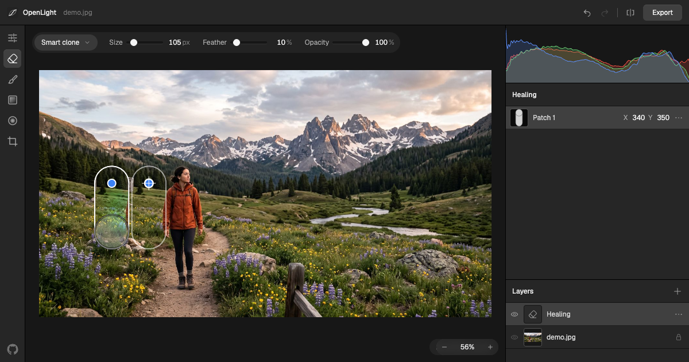

# OpenLight

**An open-source photo editor for the browser, built with [vgpu.sh](https://vgpu.sh).**
Try it at [openlight.app](https://openlight.app).

Image processing runs on your own GPU with WebGPU. Photos never leave your device.



## Features

- **Adjust:** exposure, contrast, highlights, shadows, whites, blacks, white balance with auto, vibrance, saturation, tone curves, clarity, sharpening, Color Mixer, vignette, and film grain.
- **Layers and masks:** effect layers, Color and Paint layers with Photoshop blend modes, 3D LUTs, and linear, radial, brush, luminance, and color range masks that add, subtract, or intersect.
- **Tools:** Healing with Heal, Clone, and Remove; Brush with pen pressure; crop, rotate, straighten, flip, and perspective correction.
- **Files:** open JPEG, PNG, WebP, AVIF, GIF, BMP, SVG, HEIC, TIFF, and camera RAW/DNG; import Camera Raw XMP; export PNG, JPEG, or WebP; save scenes to keep editing, with a draft recovered after closing the tab.

RAW decoding uses [raw-webgpu](https://github.com/roprgm/raw-webgpu). HEIC needs a browser with a WebCodecs HEVC decoder.

## Browser support

OpenLight requires WebGPU: a recent Chrome, Edge, Safari, or Firefox.

## Development

```sh
bun install
bun dev
```

See [AGENTS.md](AGENTS.md) for checks and conventions. `window.openlight` exposes a scripting [API](API.md).

## License

[MIT](LICENSE)
